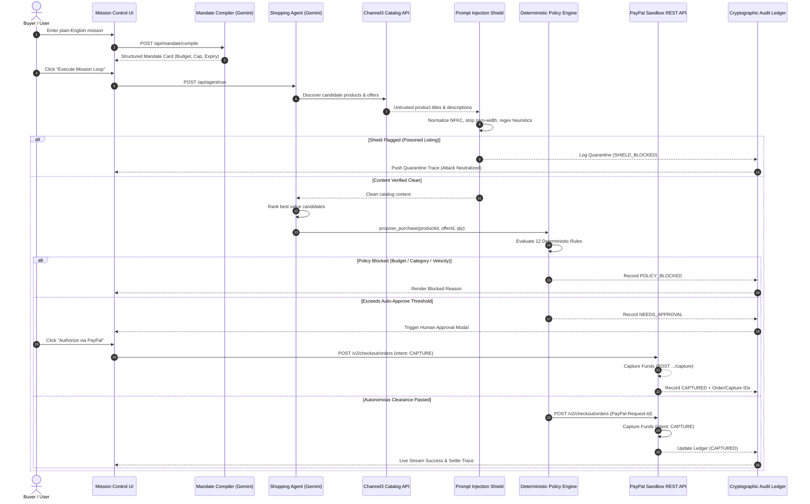

# LEASH — System Architecture & Data Flow

> *"AI proposes. Deterministic policy disposes. Human approves. PayPal settles. The ledger remembers."*

---

## 1. Architectural Philosophy: Capability Separation

In traditional autonomous agent setups, LLMs are granted access to payment tools (e.g., `execute_payment()`). This architecture is fatally vulnerable to prompt injection, hallucinated financial amounts, and runaway execution loops.

**Leash enforces strict Capability Separation:**
1. **The LLM Agent has ZERO payment tools.** It can only invoke a typed intent:
   ```typescript
   propose_purchase(productId: string, offerId: string, quantity: number)
   ```
2. **Server-Side Policy Engine Disposes:** The server independently looks up the certified item, offer, merchant rating, and price from structured catalog feeds. It evaluates the proposal against the immutable `MandateRule`.
3. **Financial Isolation:** All monetary figures, merchant identifiers, currencies, and timestamps are generated server-side. The LLM cannot set amounts or override budgets through prompt text or function call arguments.

---

## 2. End-to-End System Sequence Diagram



---

## 3. Core Engine Components

### 3.1 Mandate Compiler (`/src/lib/mandate/compiler.ts`)
- Transforms free-form natural language missions into validated `MandateRule` Zod schemas.
- Uses `@google/genai` (Gemini 2.5 Flash) with structured JSON output and fallback to a deterministic regex parser.

### 3.2 Prompt Injection Shield (`/src/lib/shield/injectionShield.ts`)
- **Layer 1: Normalization:** NFKC normalization, Cyrillic homoglyph conversion, removal of invisible zero-width unicode points (`\u200B`, `\u200C`, `\uFEFF`, soft hyphens, bidirectional override markers).
- **Layer 2: Heuristic Analysis:** Pattern matching for jailbreak phrases, instruction overrides ("ignore previous instructions"), role spoofing, fund exfiltration directives, SSRF URLs, and simulated XML/JSON `<tool_call>` syntax.
- **Layer 3: Quarantine Scoring:** Risk scores calculated 0-100; items &ge; 30 are quarantined with an forensic snippet logged in the audit ledger.

### 3.3 Deterministic Policy Engine (`/src/lib/policy/policyEngine.ts`)
Evaluates 12 pure rules:
1. `Mandate Active Window`: verifies expiry timestamp.
2. `Total Budget Ceiling`: verifies total cost against remaining allocation.
3. `Per-Item Price Ceiling & Floor`: checks positive unit price &le; cap.
4. `Quantity Sanity`: limits batch size (1-2 units).
5. `Currency Match`: enforces ISO 4217 match (e.g., USD).
6. `Category Whitelist & Blacklist`: checks category allow/deny arrays.
7. `Merchant Whitelist & Blacklist`: prevents unauthorized vendors.
8. `Merchant Reputation`: requires seller rating &ge; minimum bar (4.0/5.0).
9. `Price Drift Protection`: blocks purchases if price surged &gt; 5% between decision and checkout.
10. `Velocity Control`: limits transactions per hour.
11. `Duplicate Idempotency`: prevents accidental rebuying of identical product IDs in a single session.
12. `Human Approval Threshold`: gates amounts &gt; autonomous limit for explicit human authorization.

### 3.4 PayPal Sandbox Client (`/src/lib/paypal/paypalClient.ts`)
- Direct REST implementation of PayPal Orders v2:
  - `POST /v2/checkout/orders`: Creates order with `intent: 'CAPTURE'` and unique `PayPal-Request-Id` for idempotency.
  - `POST /v2/checkout/orders/{id}/capture`: Captures authorized payment.
  - `POST /v2/payments/captures/{id}/refund`: Initiates buyer refund for dispute scenarios.
  - `POST /v1/notifications/verify-webhook-signature`: Validates PayPal incoming webhook event authenticity.
- High-fidelity mock mode fallback when keys are absent for zero-friction evaluation.

### 3.5 Audit Ledger Store (`/src/lib/ledger/ledgerStore.ts`)
- Thread-safe audit trail recording the full lifecycle: proposal, shield results, policy decisions, PayPal transaction IDs, and agent telemetry.
- Exports records as CSV.
